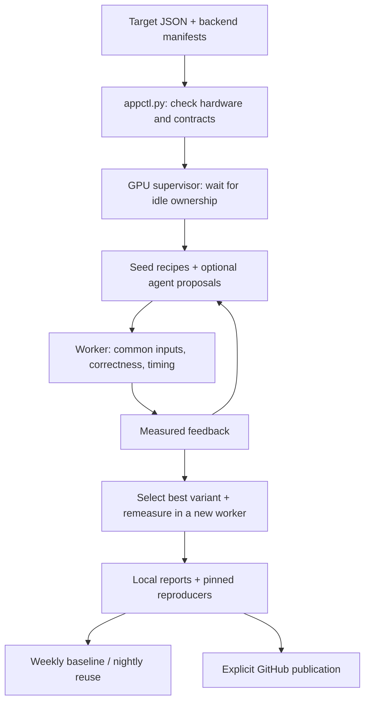

# TLX Kernel Scout

Kernel Scout compares existing kernel variants for the same workload across TLX ops, TLX tutorials,
AITER, and PyTorch. It reports the best observed variant per backend, performance, source identity,
and reproduction commands. Weekly reference measurements make nightly TLX progress cheaper to track.

The first target is [FP16 variable-length attention](targets/amd/gfx950/varlen_f16_fa.json), from
[PR #3921](https://github.com/facebookexperimental/triton/pull/3921). Its cases freeze the five
`gfx950_1` focus shapes and realized lengths, plus a causal control. Other targets cover GEMM and
BF16 dense attention. See [example output and measurement scope](https://github.com/raikonenfnu/tlx_triton/issues/27).

## Architecture

The [gfx950 target index](targets/amd/gfx950/README.md) lists the attention and GEMM workloads, source shapes, and numerical contracts.

The controller owns measurements, selection, baselines, and reports. Codex or Claude researches
source code and proposes adapters for existing implementations and supported kernel parameters.
The worker measures those adapters through one shared harness. Agent-reported timings never determine a winner.



For each target case and eligible backend, Scout measures seed recipes first. Optional discovery
uses those results for a bounded search. Scout remeasures the fastest correct, stable candidate in
a new process. Reports compare those independent measurements and account for timing uncertainty.

| Component | Responsibility |
| --- | --- |
| [appctl.py](appctl.py) | CLI, hardware admission, search loop, worker orchestration, and weekly/nightly state |
| [gpu_scheduler.py](gpu_scheduler.py) | Startup ownership polling, bounded waiting, and supervisor state |
| [contracts.py](contracts.py) | Target checks, backend eligibility, work counts, input agreement, and winner rules |
| [backends/](backends/) | Capability manifests and research instructions. [seeds.py](backends/seeds.py) supplies known variants. |
| [discovery.py](discovery.py), [coding_agents.py](coding_agents.py) | Prompt context, structured proposals, provider permissions, and timeouts |
| [benchmarking/inputs.py](benchmarking/inputs.py) | Seeded inputs, tensor fingerprints, and independent FP32 reference outputs |
| [benchmarking/worker.py](benchmarking/worker.py) | Adapter execution, correctness, common timing, and measurement evidence |
| [benchmarking/environment.py](benchmarking/environment.py) | Physical GPU identity, competing GPU processes, runtime pins, and device snapshots |
| [reporting.py](reporting.py), [publication.py](publication.py) | Performance/reproducer tables and idempotent GitHub issue updates |
| [deploy/](deploy/), [tests/](tests/) | Scheduled runner instructions and core checks |

The adapter interface is small:

```python
def build(case, params):
    # Select and prepare an existing implementation outside the timed call.
    def run(inputs):
        # Perform the operation and return a new canonical output tensor.
        ...
    return run
```

The worker calls `build` once and times `run(inputs)`. Input-dependent padding, packing, copies,
and output extraction belong inside `run`. An adapter must not cache answers or change harness
inputs. Seed and generated adapters use the same contract. Kernel rewriting belongs to the kernel optimizer.

## Benchmark contract

All backends receive the same dtype, shapes, strides, masks, and seeded tensor values. Scout checks
actual input fingerprints across backends, including frozen controls. At least two correctness
seeds check the FP32 reference, output shape/dtype/device, finiteness, input mutation, and output aliasing.

Timing uses eager `triton.testing.do_bench` with common warmup, duration, cache behavior, quantiles,
and repeats. Unstable candidates cannot win. Reports show latency and useful TFLOP/s or logical
TB/s. These throughput metrics count workload operations or bytes, not hardware counters.
Scout records device conditions and source/compiler/runtime identities without changing clocks.

Read [benchmark fairness](skills/benchmark-fairness/SKILL.md) before changing a measured operation.
Search budgets limit coverage. A missing seed does not establish that a backend lacks a compatible
implementation. Generated adapters are executable Python, and correctness checks do not prove arbitrary code is honest.

## Run locally

Use a source-built TLX checkout and its virtual environment. Place source Triton before wheel
Triton on `PYTHONPATH`. The controller rejects a base runtime that imports Triton outside this checkout.

```bash
cd third_party/tlx/tools/agents/kernel_scout
export PYTHONPATH=/path/to/triton/python:/path/to/torch/site-packages
/path/to/venv/tlx.venv/bin/python appctl.py validate targets/amd/gfx950/*.json

# Preview a small weekly run.
/path/to/venv/tlx.venv/bin/python appctl.py run --mode weekly \
  --targets targets/amd/gfx950/varlen_f16_fa.json --case one_x_1000 \
  --gpu 2 --state /path/to/scout-state

# Measure all eligible backends and freeze the weekly baseline.
/path/to/venv/tlx.venv/bin/python appctl.py run --mode weekly --execute \
  --targets targets/amd/gfx950/varlen_f16_fa.json --case one_x_1000 \
  --gpu 2 --state /path/to/scout-state

# Measure current TLX against the same week's controls.
/path/to/venv/tlx.venv/bin/python appctl.py run --mode nightly --execute \
  --targets targets/amd/gfx950/varlen_f16_fa.json --case one_x_1000 \
  --gpu 2 --state /path/to/scout-state
```

Choose an available physical GPU index for `--gpu`. Scout maps it to logical GPU 0 and checks its
PCI identity. On AMD, it sets ROCR visibility before HIP visibility. Keep the same targets,
case filter, GPU, and state directory for weekly and nightly runs. Remove `--case` for all cases.
Preview creates a run directory but performs no discovery or GPU measurement.

Manual and cron runs share a GPU supervisor. It checks ownership immediately, then once per minute for up to 30 minutes.
Measurement starts automatically when the GPU becomes idle. Unknown ownership fails immediately.
Use `--gpu-wait-seconds` and `--gpu-poll-seconds` to change these defaults.
The run directory records supervisor state in `gpu_admission.json`.

The default `--provider builtin` measures known recipes without an LLM. Add these options to a
run for discovery:

```bash
--provider claude --context /path/to/megabrain/context.md --rounds 2 --max-candidates 6
```

`codex` is also supported. Authenticate the selected CLI first. `--context` explicitly supplies
project knowledge to each agent invocation. Discovery restricts agents to source research.
`--max-candidates` includes seeds, and `--rounds` bounds discovery iterations. Use `--model`,
`--agent-timeout`, and `--worker-timeout` to configure provider and process limits.

For separate backend environments, supply `--runtimes /path/to/runtimes.json`:

```json
{"aiter": {"python": "/path/to/aiter/bin/python", "pythonpath": "/path/to/aiter-triton/python:/path/to/torch/site-packages"}}
```

Every runtime must select the same physical device and preserve the operation contract.
Scout records runtime differences. Dependency installation and source builds remain deployment tasks.
For AITER, follow [virtual environment setup](backends/aiter/setup.md) before running discovery.
Its default baseline measures public operators and uses AITER's dispatch without an LLM.
Add `--aiter-search` for alternative kernels and optional agent discovery.
The report labels GEMM dispatch and Torch fallback.
In search mode, its agent researches the installed AITER checkout and receives that runtime's source identity.

## Weekly state and operation

| Mode | Fresh measurements | Reused measurements |
| --- | --- | --- |
| Weekly | All eligible backends | None. Freeze PyTorch, AITER, and the selected TLX ops baseline. |
| Nightly | Backends with `cadence="nightly"`, currently TLX ops and tutorials | Weekly PyTorch/AITER controls and `tlx_ops_baseline` |

A campaign identifies the architecture and effective target configurations, including selected cases.
Weeks start Monday in UTC. Baselines are immutable. Nightly permits current TLX source changes
but requires compatible target, harness, device/runtime, dependency, and backend registry identities.
Changed contracts require a fresh weekly baseline. Use a new state directory to repeat an existing week's weekly run.

Frozen controls retain their measurement dates. Nightly tables track trends against those controls.
Run a fresh weekly comparison when every backend must have a current measurement.

```text
STATE/
  baselines/<campaign>/<week>.json       # Immutable weekly report
  runs/<date>_<mode>_<timestamp>/
    gpu_admission.json                  # GPU supervisor state and ownership checks
    report.md / report.json             # Tables and structured results
    device.json / probe.log             # Hardware and runtime evidence
    <target>/<case>/<backend>/
      search.json                       # All evaluated candidates and feedback
      discovery_*                       # Agent responses and generated adapters
      r*/                               # Candidate request, measurement, and worker log
      confirmation/                     # Selected variant's independent remeasurement
```

Start investigation with `report.md`, then inspect the backend's `search.json` and candidate logs.
The report includes reproduction commands. They reject changed source, compiler, runtime, harness,
adapter, or device pins. Preserve original checkouts, environments, and artifacts for reproduction.

| Symptom | Next action |
| --- | --- |
| `unsupported` | Check the hardware/operation manifest and seed coverage. Enable discovery when a seed is missing. |
| `unavailable` | Install the missing dependency in the intended runtime. AITER requires supported AMD hardware. |
| `blocked` discovery or provider error | Check provider authentication, permissions, and discovery logs. |
| `failed` or `unstable` candidate | Inspect correctness errors or timing spread in its measurement and worker log. |
| Baseline mismatch | Check changed contracts and runtime identities. Create a compatible weekly baseline. |
| Device admission or lock failure | Check the selected GPU, competing processes, and overlapping Scout jobs. |

Publication is a separate command and previews by default:

```bash
/path/to/python appctl.py publish --report /path/to/run/report.json --repo raikonenfnu/tlx_triton
/path/to/python appctl.py publish --report /path/to/run/report.json --repo raikonenfnu/tlx_triton --execute
```

Weekly publication checks the new owned issue before linking and closing previous campaign weeks.
Nightly publication updates one dated comment on that week's open issue. Local artifacts remain
the detailed evidence. See [deployment instructions](deploy/README.md) for configuration, cron,
optional source refresh, and failure handling. The runner measures before publishing and does not install cron or update Megabrain automatically.

## Extend and check

Read the relevant skill before changing a contract:

| Change | Entry point |
| --- | --- |
| Add workload cases for an existing operation | [Create-target skill](skills/create-target/SKILL.md) and target JSON |
| Add an operation or benchmarker | [Authoring guide](skills/create-target/references/target-authoring.md): contracts, inputs, oracle, work counts, and backend support |
| Add a backend or existing variant | [Registration skill](skills/register-backend/SKILL.md), backend manifest/instructions, and `backends/seeds.py` |
| Change agent search | `discovery.py` and `coding_agents.py`. Keep timing in the worker. |
| Change timing or reporting | [Fairness skill](skills/benchmark-fairness/SKILL.md), worker, contracts, and reporting |
| Change schedules or publication | `deploy/run.py`, deployment configuration, and `publication.py` |

Create a starter target with the existing operation contract:

```bash
python appctl.py target-init --id my_varlen_f16_fa \
  --operation flash_attn_varlen --vendor amd --arch gfx950 \
  --output targets/amd/gfx950/my_varlen_f16_fa.json
```

Replace starter cases with the intended workload. Check the config before GPU measurement.
Run CPU tests for core behavior changes:

```bash
/path/to/venv/tlx.venv/bin/python -m pytest tests -s --tb=short
```

Tests cover contracts, work counts, selection, baseline compatibility, fake provider protocols,
and GitHub publication transitions. Tests do not publish real issues. For harness or adapter
changes, also check a small GPU case and its pinned reproducer. The opt-in GPU test exercises
source-built TLX and rejects an incorrect adapter that mutates inputs:

```bash
ROCR_VISIBLE_DEVICES=GPU-<uuid-from-rocminfo> HIP_VISIBLE_DEVICES=0 CUDA_VISIBLE_DEVICES=0 SCOUT_PHYSICAL_GPU=2 \
  SCOUT_TEST_GPU=1 /path/to/venv/tlx.venv/bin/python -m pytest tests -s --tb=short
```

Use the HSA UUID for the selected AMD SMI physical GPU. Scout maps these identities automatically for `--gpu`.
AMD SMI and HSA device ordinals can differ. See [ROCm GPU isolation](https://rocm.docs.amd.com/en/docs-6.0.2/conceptual/gpu-isolation.html).
Live provider discovery needs a separate
check because fake CLI tests establish protocol behavior only.
